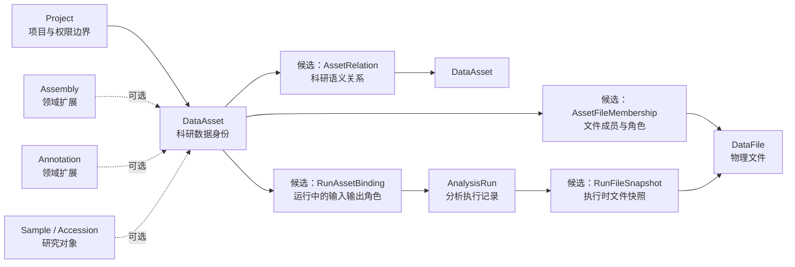

# GeneData DataAsset 通用科研数据仓库整体设计方案 v0.2

## 1. 文档状态与用途

本文是 GeneData 下一阶段通用科研数据仓库建设的详细候选设计稿，用于子 ADR 编写和分阶段实施规划。

本文不是已生效的实施指令，不表示相关 Model、migration、API、权限、前端或生产数据迁移已经完成。`ADR-001` 已批准 DataAsset 统一身份和 Dataset 退役的稳定边界；具体字段、数据库结构、权限机制和迁移方式仍须由子 ADR 批准后实施。

已确认的目标方向：

> `DataAsset` 最终取代现有 `Dataset`，成为 GeneData 中唯一的科研数据身份。

其他课题组即使没有 `Species`、`Accession`、`Sample`、`Assembly` 或 `Annotation`，也应能仅使用 `Project + DataAsset + DataFile` 完成数据入库、查询、复用和追溯。

已批准依据：`docs/adr/ADR-001-dataasset-unified-identity.md`。

### 1.1 评审后修订原则

本版已结合实施评审意见收敛近期范围，但不以“少建表”为理由延后从第一条正式数据开始就必须存在的数据完整性、版本、授权和可复现性语义。

采纳的意见：

- 长期目标架构与近期实施范围分开；
- 先完成事实核验、Dataset 审计和 ADR，再修改 Model；
- Masterdata / SchemaRegistry 先行；
- 第一阶段使用版本控制的 YAML/JSON，不建设网页编辑器；
- Assembly、Annotation 领域映射、完整权限体系和 Dataset 生产迁移后置；
- 先用 IR64、MICROSCOPY、TABLE 证明通用性，再扩大实施范围。

不采纳的意见：

- 不把字符串多态 `FileRelation` 作为 DataAsset 的正式核心文件关系；
- 不使用无字段的自动 M:N 保存 AnalysisRun 输入输出；
- 不把 `schema_version`、`schema_digest`、`visibility`、`created_by` 延后到已有正式数据之后；
- 不让普通业务 DataAsset 长期处于无 Project 归属状态；
- 不重新开放 Dataset 与 DataAsset 是否长期并存的目标决策。

物理表数量和候选模型名称仍由 ADR 决定。例如资产级 Run 绑定与文件快照可以由一个显式 through model 承担，也可以分为两张表；但方向、角色、顺序、文件版本和 checksum 快照等语义不能省略。

## 2. 建设目标

GeneData 的目标不是建设单一物种、单一组学或单一分析流程数据库，而是建设可长期演进的通用科研数据管理平台。

系统应能够：

1. 管理基因组、注释、测序数据、变异、表达矩阵等生物信息学数据；
2. 扩展到显微图片、普通表格、质谱结果、表型数据等其他科研类型；
3. 新增普通数据类型时不修改核心 Django Model、migration、API 路由或前端字段代码；
4. 统一管理物理文件、checksum、版本、权限和发布状态；
5. 保存分析输入、输出、软件版本、参数、执行状态、日志和文件快照；
6. 支持从结果追溯输入、参考数据和分析过程，并查询下游数据；
7. 保留 Assembly、Annotation 等专业实体的领域能力，但不形成第二份科研数据身份；
8. 使前台操作简单，同时保持后台数据、来源、权限和过程可审计。

## 3. 非目标

本设计不包含以下目标：

- 不在第一阶段建设通用工作流调度平台；
- 不在第一阶段建设复杂网页 Masterdata 编辑器；
- 不把所有专业字段塞入一个无约束 JSON；
- 不复制 openBIS 的完整 Space、Collection、Object 和存储体系；
- 不在一个任务中同时完成 Dataset 迁移、权限重构、API、Vue 和生产切换；
- 不新增 `GenomeFile` 业务依赖、fallback 或双写；
- 不把 `FileRelation` 扩展为承载所有血缘、版本和执行语义的通用关系表；
- 不允许 Dataset 和 DataAsset 长期双读、双写或共同作为活动事实来源。

## 4. 当前事实、目标状态与待决策项

### 4.1 当前已核实事实

截至 2026-11-18，当前仓库事实包括：

- Django 后端位于 `django2/`，主应用为 `django2/files/`；
- 当前存在 `Project`、`Dataset`、`Assembly`、`Annotation`、`DataFile`、`FileRelation` 等模型；
- `DataFile + FileRelation` 是当前文件管理活动主链路；
- `Dataset` 当前承担部分科研数据分组、类型、项目、版本、状态和可见性职责；
- `Assembly` 和 `Annotation` 同时保存领域字段和部分通用身份字段；
- `FileRelation` 使用 `related_type + related_id + related_code` 字符串多态关系；
- `DataAsset` 稳定架构边界已由 ADR-001 批准，但应用代码和 migration 尚未实现；`AnalysisRun` 和最终血缘物理模型仍未批准；
- 当前数据血缘设计状态仍为 draft；
- 部分现有数据详情和下载入口使用 `AllowAny`，不能直接作为新血缘 API 的授权基础。

### 4.2 已确认目标状态

- `DataAsset` 是唯一科研数据身份；
- `Dataset` 完成迁移和验收后退役；
- `DataFile` 是唯一物理文件身份；
- `AnalysisRun` 是真实分析执行记录；
- Masterdata 负责类型、字段、词表和校验规则；
- `Species`、`Accession`、`Sample` 是可选研究对象；
- `Assembly`、`Annotation` 是可选领域扩展；
- 所有血缘节点和文件必须逐节点授权。

### 4.3 尚待子 ADR 决定

- `DataAsset`、文件成员关系、Run 输入输出关系的最终模型名称；
- Run 资产角色和文件快照使用一张显式 through 表还是两张职责分离的表；
- DataAsset 与 Assembly、Annotation 的物理关联方式和迁移顺序；
- 项目成员、课题组和共享数据的权限模型；
- DataAsset 发布后不可变的具体规则；
- Dataset 表最终删除的生产门槛和回滚窗口。

## 5. 稳定架构原则

### 5.1 一个概念只有一个事实来源

| 概念 | 唯一事实来源 |
| --- | --- |
| 科研数据 code、名称、版本、状态、可见性 | DataAsset |
| 物理路径、大小、格式、checksum | DataFile |
| 项目归属和权限入口 | Project 及授权服务 |
| Assembly 专业指标 | Assembly |
| Annotation 专业关系和字段 | Annotation |
| 生物材料或外部登录身份 | Accession |
| 实验样本身份 | Sample |
| 软件、参数、执行时间、状态和错误 | AnalysisRun |
| 类型、字段和词表定义 | Masterdata Registry |

### 5.2 通用核心不依赖生物学层级

所有课题组都应能使用：

```text
Project
   ↓
DataAsset
   ↓
DataFile
```

如果存在分析过程：

```text
输入 DataAsset / DataFile
          ↓
     AnalysisRun
          ↓
输出 DataAsset / DataFile
```

`Species`、`Accession`、`Sample`、`Assembly` 和 `Annotation` 均不是 DataAsset 的必填上级。

### 5.3 受控通用性

普通新类型应通过配置扩展，但以下概念不能为了“零 migration”全部塞入 JSON：

- 需要独立身份和权限的实体；
- 需要真实外键和数据库约束的关系；
- 被多个模块长期引用的专业对象；
- 需要高频检索、统计或独立生命周期的对象。

## 6. 总体架构



系统分为六层：

1. Project 和权限边界；
2. DataAsset 科研数据身份；
3. DataFile 物理文件；
4. AnalysisRun 和数据血缘；
5. Masterdata 类型配置；
6. Assembly、Annotation 等可选领域扩展。

## 7. 核心数据模型

除 ADR-001 已批准的 `DataAsset` 名称外，以下字段、关系模型名称和物理结构仍为候选方案，需经子 ADR 批准。

### 7.1 Project

职责：

- 组织科研数据；
- 提供默认权限边界；
- 作为 DataAsset 和 AnalysisRun 的归属入口；
- 支持公共参考项目和普通课题项目。

目标原则：

- 普通 DataAsset 必须归属于一个 Project；
- 共享参考数据放入专门的公共参考项目，不以空 Project 表示；
- Project 的成员和角色权限另行设计，不在 DataAsset 核心任务中顺带完成。

为兼容历史数据回填，新增字段的第一条 schema migration 可以暂时允许 `NULL`，但正式创建服务必须从第一版要求 Project。完成回填和核对后，再通过新 migration 增加 `NOT NULL` 约束。迁移期可空不等于业务语义可空。

### 7.2 DataAsset

候选字段：

```text
asset_code          唯一、不可变
name                必填
project             必填 FK(Project)

data_type           必填，引用 Masterdata code
profile             必填，引用 Masterdata code
schema_version      必填
schema_digest       必填

version             可选，发布资产建议必填
status              必填
visibility          必填，默认 private
metadata            JSON，可为空对象
description         可空

created_by          必填，由系统写入
created_at          系统自动
updated_at          系统自动
released_at         可空
```

DataAsset 负责：

- 科研数据统一身份；
- 通用名称、版本、状态和可见性；
- 类型和 Schema 版本引用；
- 作为分析输入和输出；
- 参与科研语义关系；
- 关联一个或多个 DataFile。

DataAsset 不负责：

- 物理文件路径和 checksum；
- Assembly、Annotation 等专业字段；
- AnalysisRun 的软件、参数和日志；
- 项目成员授权规则本身。

### 7.3 DataFile

继续复用现有 DataFile 作为唯一物理文件实体。

目标规则：

- 一个 DataFile 表示一个具体文件内容；
- 文件内容变化时创建新 DataFile，不覆盖旧 checksum；
- 原始路径不返回普通前端和外部客户端；
- 下载、Range 和外部工具访问均重新授权；
- DataFile 的 checksum 和 content version 用于执行快照和可复现性。

### 7.4 DataAsset 与 DataFile 的成员关系

不把 `FileRelation.related_type = data_asset` 作为正式核心方案。目标设计采用具有真实外键的成员关系，候选名称为 `AssetFileMembership`，最终名称和字段由 ADR 决定。

理由：

- `related_type + related_id` 无法由数据库保证 DataAsset 存在；
- 无法可靠执行删除保护、级联约束和悬空关系检查；
- DataAsset 文件成员需要稳定表达 role、顺序、primary 和生命周期；
- 继续扩展字符串多态关系会把当前兼容结构固化为新的核心架构。

仅允许在不进入生产、不形成迁移数据、明确可删除的技术 Spike 中临时复用 FileRelation 验证查询；正式 DataAsset 数据不得依赖该临时路径。

候选字段：

```text
data_asset          FK(DataAsset)
data_file           FK(DataFile)
file_role           引用 FileRoleDefinition
ordinal             非负整数
is_primary          布尔值
description         可空
created_at          系统自动
removed_at          可空
```

候选约束：

```text
UNIQUE(data_asset, data_file, file_role)
ordinal >= 0
同一 DataAsset + file_role 最多一个 primary 文件
```

示例：

```text
Genome Assembly DataAsset
├── primary_fasta       primary.fasta
├── fasta_index         primary.fasta.fai
├── assembly_graph      asm.gfa
└── statistics          assembly_stats.json
```

该关系不是新的物理文件模型，物理文件仍然只有 DataFile。

## 8. Masterdata 与 Schema Registry

### 8.1 目标

Masterdata 使普通新数据类型可以在不修改核心后端结构的情况下扩展。

候选组成：

```text
DataType
Profile
ProfileVersion
PropertyDefinition
PropertyAssignment
Vocabulary
VocabularyTerm
FileRoleDefinition
ProcessType
RelationType
RunStatus
SemanticAnnotation
```

### 8.2 DataType 与 Profile

```text
DataType: SEQUENCE_READS
├── PACBIO_HIFI
├── ILLUMINA_PE
└── NANOPORE

DataType: IMAGE
├── MICROSCOPY
└── PHENOTYPE_IMAGE

DataType: TABLE
├── RAW_TABLE
├── CLEANED_TABLE
└── STATISTICAL_RESULT
```

治理规则：

- DataType 数量少且稳定；
- Profile 表达同一大类下的具体数据规范；
- 不按项目名称创建 DataType；
- 不按 BAM、FASTA、CSV 等文件格式创建 DataType；
- 项目差异优先使用默认值、模板或受控扩展，不复制完整 Profile。

### 8.3 PropertyDefinition 与 PropertyAssignment

PropertyDefinition 定义字段的稳定语义：

```text
INSTRUMENT
PLATFORM
SAMPLE_COUNT
REFERENCE_GENOME
MAGNIFICATION
```

PropertyAssignment 定义字段在某一 ProfileVersion 中的使用方式：

```text
是否必填
是否多值
显示顺序
所属 UI 分区
唯一性
默认值
允许范围
Vocabulary 引用
前端组件提示
```

### 8.4 Schema 版本

每个发布后的 ProfileVersion 必须不可变：

```text
MICROSCOPY@1
MICROSCOPY@2
```

DataAsset 必须保存：

```text
profile
schema_version
schema_digest
```

不能在不改变版本的情况下覆盖已发布 Schema，否则历史 metadata 无法稳定解释。

### 8.5 第一阶段实施方式

第一阶段建议：

```text
版本控制的 YAML/JSON Masterdata 包
只读 SchemaRegistry
通过代码评审发布
无网页配置编辑器
```

成熟后再评估：

```text
数据库 Masterdata Registry
导入、导出、审批、版本和审计
禁止直接覆盖已发布版本
```

## 9. 分析执行与数据血缘

### 9.1 AnalysisRun

候选字段：

```text
run_code             唯一、不可变
project              FK(Project)
process_type         引用 Masterdata

workflow
workflow_version
software
software_version
container_digest
parameters_snapshot
parameter_digest
idempotency_key

status
started_at
finished_at

created_by
log_file             可选 FK(DataFile)
error_summary
created_at
updated_at
```

其中 `parameters_snapshot` 保存执行时参数，不引用可变的外部配置；`idempotency_key` 用于阻止同一提交因重试产生无法区分的重复 Run。具体唯一约束和生成规则由 ADR 决定。

至少支持：

```text
PENDING
RUNNING
SUCCESS
FAILED
CANCELLED
```

### 9.2 资产级输入输出

候选名称：`RunAssetBinding`。

```text
analysis_run         FK(AnalysisRun)
data_asset           FK(DataAsset)
direction            input / output
role                 例如 input_reads、reference、primary_output
ordinal              非负整数
asset_version        执行时版本快照
metadata             可空
```

禁止使用无字段的自动 M:N 替代显式输入输出关系，因为自动 M:N 无法保存角色、顺序和执行时快照。

### 9.3 文件级执行快照

候选名称：`RunFileSnapshot`。

```text
analysis_run         FK(AnalysisRun)
data_file            FK(DataFile)
direction            input / output
role
ordinal
sha256_snapshot
content_version
file_size_snapshot
```

作用：

- 固定一次运行实际使用的具体文件；
- 防止 DataAsset 后续增加或替换文件导致历史失真；
- 支持复现、审计和失败调查。

### 9.3.1 第一阶段的最小物理实现

为了控制近期模型数量，第一阶段允许 ADR 将资产级绑定和文件级快照合并为一个显式 Run 参与关系，例如：

```text
analysis_run         FK(AnalysisRun)
data_asset           FK(DataAsset)
data_file            可空 FK(DataFile)
direction            input / output
role
ordinal
asset_version
sha256_snapshot
content_version
file_size_snapshot
metadata
```

是否拆成 `RunAssetBinding + RunFileSnapshot` 是物理实现选择，不影响以下稳定不变量：

- 必须区分 input 和 output；
- 必须保存 role；
- 多输入或多输出时必须保存稳定顺序或明确声明顺序无意义；
- 有实际文件时必须记录 DataFile 和执行时 checksum/content version；
- 历史 Run 不能因 DataAsset 后续替换文件而改变；
- 不允许先使用普通 M:N，待产生正式数据后再升级。

### 9.4 AssetRelation

AssetRelation 只表达科研语义或历史推断，不替代 AnalysisRun。

候选字段：

```text
source_asset         FK(DataAsset)
target_asset         FK(DataAsset)
relation_type        引用 Masterdata
evidence_type        actual_run / inferred / manual / imported
analysis_run         可空 FK(AnalysisRun)
metadata             可空
description          可空
created_at
```

首批关系类型可评审：

```text
annotates
uses_reference
part_of
version_of
supersedes
describes
```

规则：

- 真实执行派生以 AnalysisRun 输入输出为事实来源；
- `derived_from` 优先由 Run 计算，不允许形成第二份任意编辑事实；
- 人工和历史推断必须标记 evidence_type；
- source 和 target 的方向语义必须在 RelationType 中定义；
- 所有上下游查询必须逐节点授权。

## 10. 现有领域实体的目标处理

### 10.1 Accession 与 Sample

继续保留，定位为可选研究对象，而不是通用数据仓库根节点。

```text
Accession / Sample
        ↓ 可选上下文关联
DataAsset
```

显微图像、普通表格、质谱等数据不需要 Accession 也可完整入库。

不应通过继续扩展字符串多态关系来解决所有对象关联。稳定、高频的领域关系应优先使用真实外键和明确中间表，具体结构由独立 ADR 决定。

### 10.2 Assembly

Assembly 继续保存组装专业字段，例如：

```text
accession
assembly_method
sequencing_technology
genome_size
chromosome_count
contig_count
n50
gc_content
```

目标关系：

```text
DataAsset 1 ── 0..1 Assembly
```

DataAsset 保存通用身份；Assembly 保存领域扩展字段。现有重复名称、版本、文件名等字段需要通过独立迁移逐步停止活动使用，不能长期双写。

### 10.3 Annotation

基因组注释首先是一条 DataAsset：

```text
DataType = GENOME_ANNOTATION
Profile = STRUCTURAL_ANNOTATION
```

Annotation 继续保存专业字段和与 Assembly 的关系。目标关系：

```text
Annotation DataAsset
    ├── Annotation 专业扩展
    ├── genes.gff3
    ├── cds.fasta
    ├── proteins.fasta
    └── transcripts.fasta

Annotation Asset --annotates--> Assembly Asset
```

### 10.4 Dataset

Dataset 是明确的待退役活动模型：

```text
当前：Dataset 仍是活动实现
目标：DataAsset 取代 Dataset
完成迁移和验收后：Dataset 退役并删除活动引用
```

不允许长期保留：

- Dataset 与 DataAsset 双写；
- Dataset -> DataAsset fallback；
- 两套并行 API；
- 无删除条件的兼容 service；
- Dataset 作为第二份科研数据事实来源。

## 11. 权限与安全

### 11.1 权限范围

权限至少覆盖：

```text
Project
DataAsset
DataFile
AnalysisRun
AssetRelation
每个 lineage node
```

### 11.2 基本规则

- DataAsset 默认 private；
- DataFile 默认继承所属 DataAsset 或 Project 权限；
- 每次下载和外部工具读取均重新授权；
- 上下游查询对每个节点重新授权；
- 无权用户不能看到私有节点名称、checksum、项目、数量或存在性；
- 跨项目运行只能引用当前用户有权读取的输入；
- 输出 DataAsset 必须归属于明确的目标 Project；
- 不向客户端返回服务器 `file_path`；
- 生产关键配置缺失时安全失败。

### 11.3 待独立设计的权限能力

当前 Project 的 owner 字段不足以支撑多课题组长期权限管理。未来需要独立 ADR 设计：

```text
项目成员
角色
读、写、下载、运行和管理权限
公共发布流程
跨项目共享
审计记录
```

该能力不得在 DataAsset 核心建表任务中顺带实现。

## 12. 服务层与 API 边界

### 12.1 候选服务

```text
MasterdataRegistry
SchemaValidationService
DataAssetService
AssetFileService
AnalysisRunService
LineageService
AuthorizationService
IngestionService
```

原则：

- Serializer 只做请求格式和基础字段校验；
- SchemaValidationService 负责类型特有 metadata；
- Service 负责事务、不变量和授权编排；
- View 不复制业务规则；
- Model.save() 不承载复杂领域流程；
- 不在多个组件中散落 `if data_type == ...` 分支。

### 12.2 候选 API

以下 URL 仅为目标草案，当前尚未实现：

```text
GET  /api/v1/masterdata/data-types/
GET  /api/v1/masterdata/profiles/{code}/versions/{version}/

GET  /api/v1/projects/{id}/assets/
POST /api/v1/assets/
GET  /api/v1/assets/{id}/
GET  /api/v1/assets/{id}/files/
GET  /api/v1/assets/{id}/lineage/
GET  /api/v1/assets/{id}/runs/

POST /api/v1/runs/
GET  /api/v1/runs/{id}/
POST /api/v1/runs/{id}/complete/
POST /api/v1/runs/{id}/fail/
```

可选领域入口：

```text
GET /api/v1/accessions/{id}/assets/
GET /api/v1/assemblies/{id}/asset/
GET /api/v1/annotations/{id}/asset/
```

## 13. 通用入库与使用流程

### 13.1 最小入库流程

```text
选择 Project
    ↓
选择 DataType
    ↓
选择 ProfileVersion
    ↓
动态生成 metadata 表单
    ↓
后端验证 metadata
    ↓
创建 DataAsset
    ↓
登记 DataFile 和 checksum
    ↓
建立文件成员关系
```

### 13.2 最小 Manifest 示例

```yaml
project_code: ECOLOGY_001

assets:
  - asset_code: ECO-TABLE-001
    name: Raw Survey Table
    data_type: TABLE
    profile: RAW_TABLE
    schema_version: 1

    metadata:
      delimiter: ","
      encoding: UTF-8

    files:
      - file_code: ECO-FILE-001
        role: primary_table
        path: survey.csv
```

`Species`、`Accession`、`Sample`、`Assembly` 和 `Annotation` 均为可选导入块。

### 13.3 不同课题组示例

#### 基因组课题组

```text
IR64 HiFi Reads
        ↓ hifiasm AnalysisRun
IR64 Genome Assembly
        ↓ Annotation AnalysisRun
IR64 Genome Annotation
```

可附加 Accession、Sample、Assembly 和 Annotation 专业实体。

#### 显微图像课题组

```text
Microscopy Images
        ↓ Cell Segmentation Run
Segmentation Masks
        ↓ Measurement Run
Cell Measurement Table
```

不需要 Accession 或 Annotation。

#### 普通表格课题组

```text
Raw Survey Table
        ↓ Data Cleaning Run
Cleaned Survey Table
        ↓ Statistical Analysis Run
Statistical Result
```

同样使用 DataAsset、DataFile 和 AnalysisRun 核心。

## 14. 版本与不可变性

建议采用：

```text
Draft DataAsset
允许修改 metadata 和文件成员

Released DataAsset
身份、Schema 引用和内容冻结

需要修改已发布内容
创建新的 DataAsset 版本
建立 version_of 或 supersedes 关系
```

DataFile 内容变化时创建新的 DataFile。历史 Run 继续引用原 DataFile 和 checksum 快照。

## 15. 查询与性能

### 15.1 核心列

以下字段应作为稳定列并按真实查询建立索引：

```text
asset_code
project
data_type
profile
status
visibility
created_at
```

### 15.2 Metadata

- 不给每个 JSON 字段建立数据库索引；
- 高频、跨类型查询字段应评估提升为稳定列或受控索引；
- 低频项目字段保留在 metadata；
- 大规模全文和跨字段搜索在真实需求证明后再引入搜索引擎；
- 所有索引优化必须先通过查询计划和真实数据验证。

## 16. Dataset 迁移与退役

DataAsset 取代 Dataset 作为科研数据身份的目标已经确认。迁移前审计不是重新决定是否长期保留两套科研数据身份，而是回答以下问题：

- 当前 Dataset 是否还承担 Collection、Release 或 Manifest 发布单元语义；
- 这些语义应迁移为 DataAsset Profile、`part_of` 关系，还是另行提交 Collection ADR；
- Dataset 权限和可见性如何映射；
- DatasetAccession、DataFile.dataset、API、Manifest 和前端调用如何切换；
- 哪些历史数据无法自动判断，需要人工映射清单。

如果审计证明存在独立的 Collection/Release 概念，应为该概念建立清晰且唯一的目标结构，而不是以此为由让旧 Dataset 与 DataAsset 无期限并存。

### 16.1 字段映射基线

| Dataset | DataAsset |
| --- | --- |
| dataset_code | asset_code |
| dataset_name | name |
| dataset_type | data_type + profile |
| project | project |
| species | 可选领域关联或 metadata，待 ADR |
| version | version |
| visibility | visibility |
| status | status |
| description | description |
| created_at | created_at |
| updated_at | updated_at |

`Dataset.data_files`、`DatasetAccession`、Dataset 权限策略、Manifest、服务、API 和前端依赖必须全部纳入盘点。

### 16.2 分阶段迁移

```text
阶段 0：调用、数据、权限和前端盘点
阶段 1：批准 DataAsset 与 Masterdata ADR
阶段 2：新增结构和测试，不切换活动读写
阶段 3：建立 Dataset -> DataAsset 映射和 dry-run
阶段 4：分批、幂等回填
阶段 5：核对记录数、关系、权限和 checksum
阶段 6：一次性切换活动读写到 DataAsset
阶段 7：生产验收和回滚观察期
阶段 8：删除 Dataset 活动引用
阶段 9：通过新 migration 删除旧表
阶段 10：CI 增加防回流检查
```

迁移期间的事实来源规则：

```text
切换前：Dataset 是活动事实来源
切换后：DataAsset 是活动事实来源
```

允许受控的影子回填和验证，不允许无期限双写。

### 16.3 回填要求

- 支持 dry-run；
- 支持有限批次；
- 幂等；
- 可失败重试；
- 输出审计清单；
- 不在阻塞式 schema migration 中完成大规模回填；
- 不连接或修改未经批准的生产数据库；
- 删除旧表前完成备份、checksum 和恢复验证。

### 16.4 Dataset 删除门槛

```text
[ ] Dataset 数据全部映射到 DataAsset
[ ] DataFile 关系全部迁移
[ ] DatasetAccession 等关系全部迁移
[ ] 权限和可见性结果一致
[ ] API、service、command、admin 无 Dataset 活动引用
[ ] Vue 无 Dataset 活动依赖
[ ] 外部工具和 Manifest 已切换
[ ] 回填 dry-run、幂等和重试证据完整
[ ] 备份和恢复验证完成
[ ] 生产真实数据验收完成
[ ] CI 防回流检查生效
```

## 17. 分阶段开发计划

### 阶段 A：架构和事实验证

范围：

- 当前 Dataset、DataFile、FileRelation、Assembly、Annotation 调用盘点；
- 数据样例和关系基线；
- Dataset 的科研数据身份、Collection、Release 和 Manifest 语义审计；
- 权限风险盘点；
- DataAsset/Dataset 字段映射；
- ADR。

禁止：

- 修改 Model；
- 生成 migration；
- 修改生产数据。

### 阶段 B：Masterdata 原型

范围：

- 版本化 SchemaRegistry；
- PropertyDefinition 和 PropertyAssignment；
- Vocabulary；
- FileRole；
- ProfileVersion、schema digest 生成和不可变加载；
- `PACBIO_HIFI`、`MICROSCOPY`、`TABLE` 测试配置。

Gate：

```text
[ ] 三种数据使用同一 Registry
[ ] 只改配置即可增加 Profile
[ ] 无数据库 migration
[ ] 旧 Schema 版本仍可加载
[ ] 每个已发布 ProfileVersion 具有稳定 version 和 digest
```

### 阶段 C：最小核心后端

候选范围：

- DataAsset；
- DataAsset 与 DataFile 成员关系；
- AnalysisRun；
- 显式 Run 输入输出；
- 文件级执行快照；
- model、migration 和 model/service 测试。

实施约束：

```text
[ ] DataAsset 正式文件成员使用真实 FK，不扩展 FileRelation 作为核心模板
[ ] DataAsset 从第一版保存 schema_version 和 schema_digest
[ ] 普通创建服务要求 Project、visibility 和 created_by
[ ] Run 使用显式 through 关系，不使用普通 M:N
[ ] 有实际文件的 Run 保存 DataFile 和 checksum/content version 快照
[ ] AssetRelation 保存 evidence_type，或第一阶段不开放人工关系写入
```

为控制模型数量，Run 的资产角色和文件快照可以先由一个显式 through model 表达；拆表与否由 ADR 和试点查询决定。

不包含：

- API；
- Vue；
- 生产回填；
- Assembly/Annotation 大规模重构。

### 阶段 D：试点验证

用例：

- IR64 HiFi Reads -> Assembly -> Annotation；
- Microscopy Images -> Segmentation Masks；
- Raw Table -> Cleaned Table；
- 失败 Run 和部分输出；
- 私有输入、公开输出的授权边界；
- 文件内容更新后的历史 Run 复现。

### 阶段 E：API 与授权

范围：

- Masterdata 只读 API；
- DataAsset API；
- AnalysisRun API；
- Lineage API；
- 逐节点授权测试；
- 不泄露私有节点存在性。

### 阶段 F：Vue 动态界面

范围：

- Project 资产入口；
- 动态 DataAsset 表单；
- 文件成员及角色；
- Run 详情；
- 上下游追溯；
- 不硬编码具体 Profile 字段。

### 阶段 G：Dataset 迁移与退役

范围：

- dry-run；
- 分批回填；
- 一致性核对；
- 活动读写切换；
- 生产验收；
- 删除活动引用；
- 最终删除表和防回流。

## 18. 通用性验收标准

```text
[ ] 普通课题组无需 Accession 即可入库
[ ] 新普通类型只增加 Masterdata 和测试
[ ] 不修改核心 model、serializer 和前端字段代码
[ ] DataAsset 是唯一科研数据身份
[ ] DataFile 是唯一物理文件身份
[ ] DataAsset 正式文件成员关系具有真实 FK 和数据库约束
[ ] AnalysisRun 保存资产角色和文件快照
[ ] AnalysisRun 未使用无字段自动 M:N
[ ] Schema、Vocabulary 和 RelationType 可版本化
[ ] 每条 DataAsset 可追溯到确切 schema version 和 digest
[ ] 所有血缘节点逐节点授权
[ ] Assembly/Annotation 不重复保存活动通用身份
[ ] Dataset 有明确迁移和删除门槛
[ ] IR64、显微图片、普通表格使用同一核心服务
[ ] 失败、取消和部分输出路径有测试
[ ] 生产 migration、数据回填和权限验收独立执行
```

建议增加第四种完全不同的验收类型，例如 `METABOLOMICS / LC_MS`。如果仍能只增加 Masterdata、示例数据和测试，而无需修改核心结构，才可认为通用性得到初步证明。

## 19. 主要风险

| 风险 | 影响 | 控制措施 |
| --- | --- | --- |
| DataAsset 与 Dataset 长期并存 | 两份事实来源 | 明确切换点和删除门槛，禁止无期限双写 |
| DataAsset 与 Assembly/Annotation 重复字段 | 同步和权限不一致 | 通用身份归 DataAsset，专业字段归扩展实体 |
| 完全自由 metadata | 字段混乱、无法查询 | 版本化 Schema、PropertyDefinition、Vocabulary |
| 每项目复制 Profile | 配置臃肿 | DataType 稳定、Property 复用、项目只做受控扩展 |
| 正式复用字符串 FileRelation | 悬空关系、约束不足、迁移债务 | DataAsset 文件成员使用真实 FK；FileRelation 保留当前兼容职责 |
| 自动 M:N 输入输出 | 无角色、无快照、不可复现 | 显式 Run 参与记录和文件快照 |
| 延后 Schema 版本 | 历史 metadata 无法确定校验依据 | 从第一条 DataAsset 保存 version 和 digest |
| AssetRelation 与 Run 重复派生 | 血缘冲突 | Run 为真实执行事实来源，关系标记 evidence_type |
| 上下游接口泄露私有数据 | 安全事故 | 逐节点授权和存在性保护 |
| 大规模回填阻塞部署 | 生产风险 | 批次、幂等、dry-run、重试和独立 Gate |
| JSON 查询性能下降 | 页面和 API 变慢 | 稳定列索引、选择性索引、真实查询计划验证 |

## 20. 参考方法

本设计借鉴 openBIS 的以下思想，但不复制其完整实现：

- Entity Type / Dataset Type；
- Property Type；
- Property Assignment；
- Controlled Vocabulary；
- Masterdata 导入导出；
- Semantic Annotation；
- 类型驱动的动态表单和校验。

参考：

- <https://openbis.readthedocs.io/en/7.x/software-developer-documentation/apis/python-v3-api.html>
- <https://openbis.readthedocs.io/en/7.x/user-documentation/general-admin-users/admins-documentation/new-entity-type-registration.html>
- <https://openbis.readthedocs.io/en/7.x/software-developer-documentation/apis/examples/semantic-annotations.html>
- <https://openbis.readthedocs.io/en/7.x/user-documentation/general-users/data-upload.html>

## 21. 下一步人工决策

ADR-001 已批准：DataAsset 作为 Dataset 的唯一目标替代模型、DataFile 继续作为唯一物理文件、DataAsset 与 DataFile 使用显式真实外键成员关系、专业实体为可选扩展，以及 Dataset 按独立阶段退役。

在任何 Model 实施前，仍需要人工批准：

1. DataAsset 最小字段、索引、状态机和 constraint；
2. 文件成员关系的最终模型名称、角色来源和 primary 约束；
3. Dataset 审计后的 Collection、Release 和 Manifest 语义去向；
4. Project 成员、visibility、发布状态和逐节点授权规则；
5. 第一阶段 Masterdata/Profile/Schema Registry 的物理实现；
6. AnalysisRun 的显式 input/output、role、DataFile 和版本快照结构；
7. AssetRelation 的 evidence_type、方向语义和与 AnalysisRun 的主从规则；
8. Assembly、Annotation 作为 DataAsset 领域扩展的具体关联和迁移顺序；
9. 生产 Dataset 只读审计、回填、切换、兼容窗口和删除门槛。

下一步应先完成生产只读审计和子 ADR，不应直接创建全部核心表。
